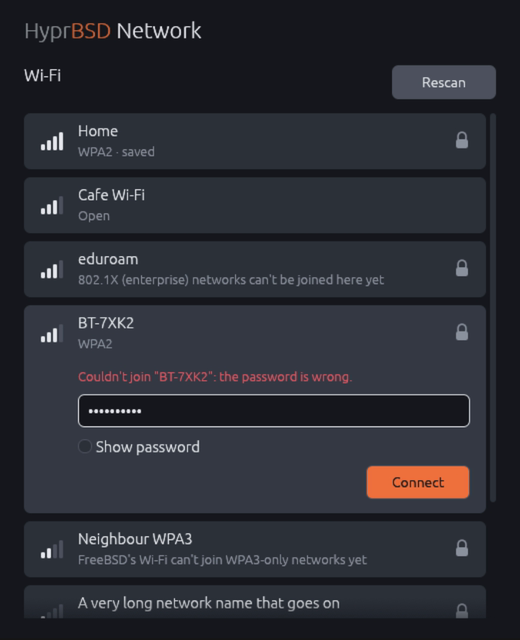
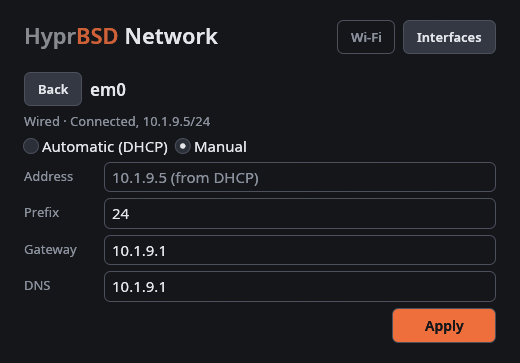
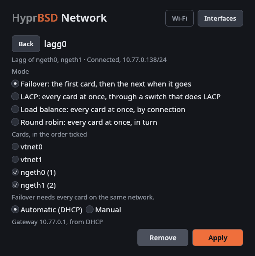

# hyprbsd-network


[](https://buymeacoffee.com/sheridans)

Wi-Fi and network settings for [HyprBSD](https://hyprbsd.org). The window lists the Wi-Fi
networks in range, joins and forgets them, and turns Wi-Fi on and off. Its Interfaces tab sets
each network card to DHCP or a fixed address, gateway and DNS, and makes link aggregations
(lagg). You can also list, join and forget Wi-Fi networks from a terminal, and
`hyprbsd-network status --follow` prints connection updates as JSON for Waybar.







It runs as you and talks to FreeBSD's own wpa_supplicant. Setting up Wi-Fi, turning it or a
card on and off, and changing a card's settings go through its root helper,
`hyprbsd-network-helper`, using pkexec. hyprbsd-network(8) has the details.

## Install

It comes with HyprBSD, which builds it from this repository's releases.

## Usage

- **From the menu:** HyprBSD Network, under Settings.
- **`hyprbsd-network`** opens the window, or brings forward the one already open.
- **`hyprbsd-network list`** lists the networks in range, **`join NAME`** joins one,
  **`forget NAME`** forgets it, and **`status`** shows the connection.
- **The manual page:** `man hyprbsd-network`.

## Building

On HyprBSD you need Rust (FreeBSD's `rust` package) and `git`; `make deny` also needs
`cargo-deny`:

```
make            # target/release/hyprbsd-network
make check      # rustfmt's check, the tests, clippy, the manual page and installation checks
make deny       # cargo-deny: the crates' licences, advisories and sources (deny.toml)
make install    # as root, under /usr/local; then service devd restart
```

Run `make check` as an ordinary user: as root, the helper's tests skip some of their cases.
[CONTRIBUTING.md](CONTRIBUTING.md) has the tests, including the ones in bhyve guests, and how a
release is made. Report security problems privately: see [SECURITY.md](SECURITY.md).

## Licence

BSD-2-Clause; see `LICENSE`.
